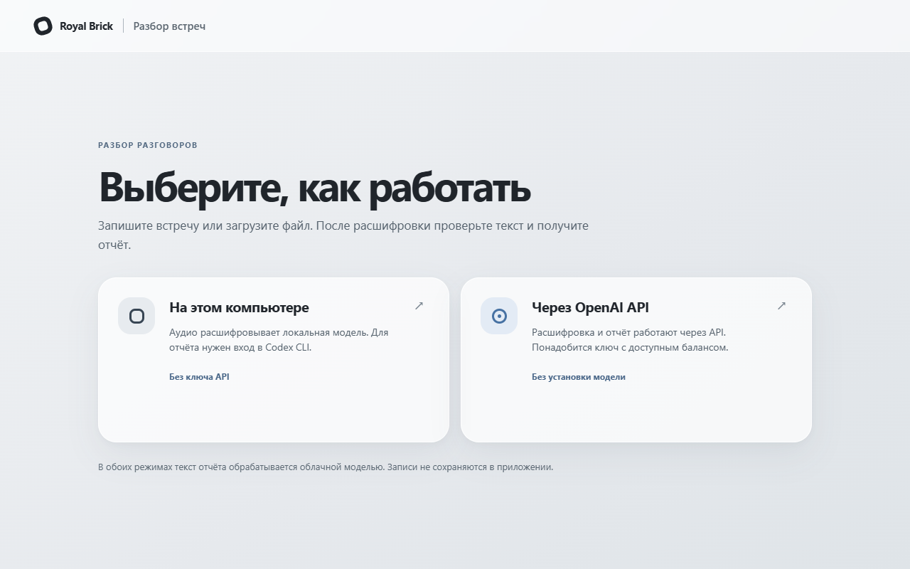

# Разбор встреч Royal Brick

Прототип для тестового задания. Записывает разговор с микрофона или принимает аудиофайл, расшифровывает русскую речь, даёт исправить текст и формирует отчёт по промпту. На первом экране можно выбрать локальную обработку аудио или OpenAI API.



## Запуск на Windows

Нужен Python 3.11+. В локальном режиме для этапа анализа также нужен Codex CLI с выполненным входом в аккаунт. Без него запись и расшифровка работают. В папке проекта запустить `run.cmd` двойным щелчком или из PowerShell:

```powershell
.\run.ps1
```

Открыть http://127.0.0.1:8060/. Скрипт создаст отдельное окружение `.venv` и установит зависимости при первом запуске. Модель `faster-whisper small` также загружается при первом использовании (примерно 460 МБ); после этого работает локально. Для записи в браузере нужно разрешить доступ к микрофону.

В режиме OpenAI API нужен свой ключ с доступным балансом. Ключ вводится на странице и передаётся с запросом через этот сервер в OpenAI. Приложение не сохраняет ключ, но владелец сервера технически может видеть проходящие через него запросы. Для конфиденциальных встреч лучше запускать проект на своём компьютере. Аудио в API-режиме ограничено 25 МБ локально и 4 МБ на Vercel из-за лимита загрузки платформы.

## Что проверить

1. Выбрать режим на первом экране. Для API ввести ключ. Нажать «Начать запись», сказать несколько фраз, остановить запись. Или загрузить файл m4a/mp3/wav/webm/ogg/mp4.
2. Нажать «Расшифровать запись». Дождаться текста с временными метками.
3. Поправить текст и, если известно, указать менеджера и дату.
4. Нажать «Разобрать встречу», затем скачать отчёт в Markdown.

Для быстрого теста можно сразу вставить готовую расшифровку в поле, без аудио.

По умолчанию используется `prompt.example.txt`. Для разбора по своему ТЗ сохраните его текст в `royal-brick-prompt.txt` рядом с `app.py` и перезапустите сервер. Этот файл не попадёт в Git. Автоматические цитаты и цифры стоит сверять с аудио.

## Как устроено

- FastAPI принимает аудио и передаёт его локальной модели `faster-whisper` либо OpenAI `gpt-transcribe`. Временный файл удаляется после расшифровки.
- Расшифровка вместе с промптом передаётся в Codex CLI либо в OpenAI Responses API (`gpt-6.1-sol`). В обоих случаях текст разговора покидает компьютер.
- Полученный отчёт показывается в браузере и скачивается как `.md`.
- Аудио, расшифровки и отчёты не записываются в базу. В браузере данные сохраняются только до закрытия страницы.

## Границы прототипа

Модель не определяет говорящих по голосам. В ролях менеджера и клиента она может ориентироваться только по тексту, поэтому перед анализом стоит проверить расшифровку и при необходимости подписать реплики. Оценки строятся по доступным данным, а не по интонации или действиям вне записи. Длинная запись на CPU обрабатывается несколько минут или дольше. Нет CRM, пользователей, фоновой очереди и постоянного хранения. На Vercel доступен только API-режим: локальную модель там не запускаем.

Исходные записи встреч, расшифровки, отчёты и промпт заказчика не входят в репозиторий. Здесь опубликован только код и пример промпта.
